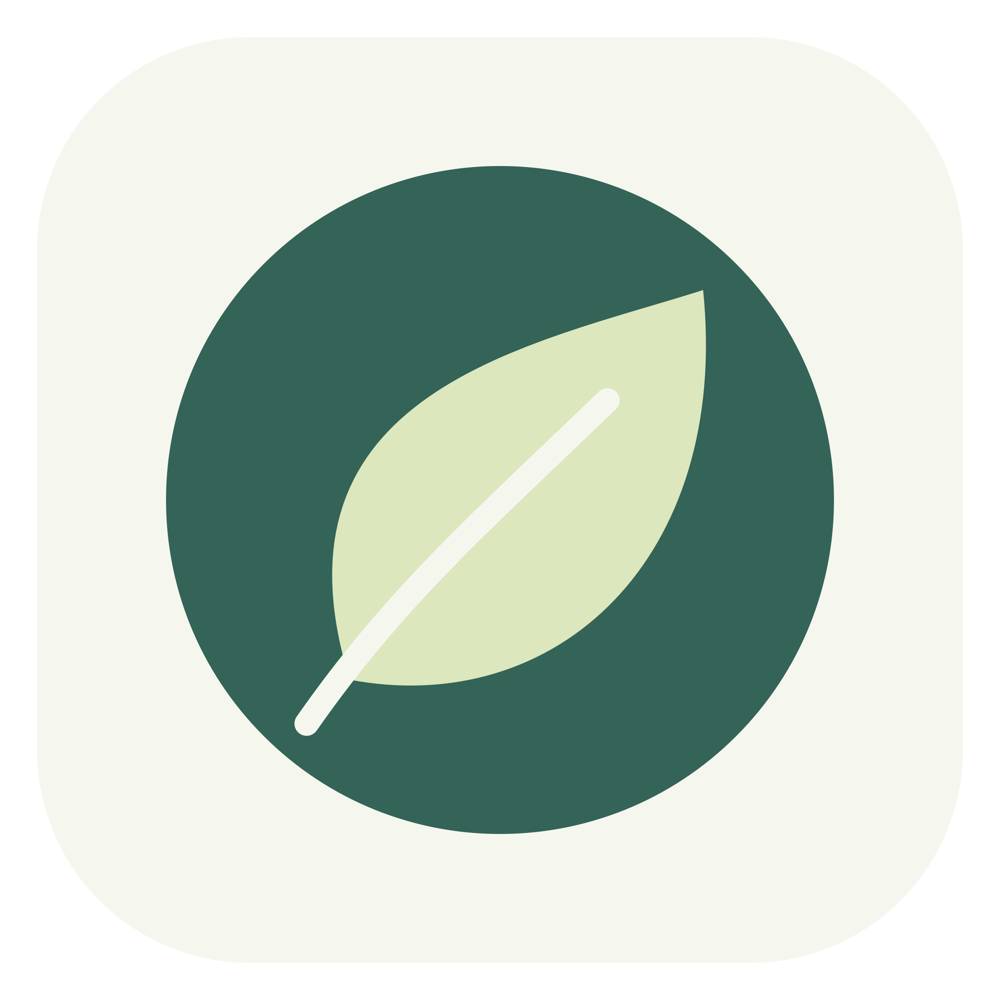

# 轻扫 QingSweep

**看清 Mac 空间占用，确认以后再清理。**

轻扫是一款本地运行的 macOS 磁盘分析与清理工具。可以按应用或文件夹查看占用，把旧安装包、缓存、日志与个人文件分开，再决定哪些内容移到废纸篓。

**当前版本：1.8.1 Beta（构建 16）。暂未使用 Apple Developer ID 签名，暂未完成 Apple 公证。** 下载后可能出现开发者验证提示。首次启动与权限操作见[安装授权说明](docs/INSTALL.zh-CN.md)。

[下载安装包](https://github.com/FishyJ10312/QingSweep/releases/download/v1.8.1-beta/QingSweep-1.8.1-beta-arm64.zip) · [Beta 发布页](https://github.com/FishyJ10312/QingSweep/releases/tag/v1.8.1-beta) · [反馈问题](https://github.com/FishyJ10312/QingSweep/issues/new?template=bug_report.md)

## 怎么用

1. 选择扫描范围，按应用或文件夹查看空间去向。
2. 查看分类、占用与清理影响，选择需要处理的文件。
3. 复核清单，可以取消整组或单项；需自行确认的内容还会经过二次确认。
4. 文件移到废纸篓后，可在「清理记录」按批次恢复到原位置。

| 分类 | 含义 | 选择方式 |
| --- | --- | --- |
| 红色 · 推荐清理 | 已识别规则下的旧安装包、部分可重建缓存等候选 | 点击添加建议项后，再复核清单 |
| 蓝色 · 可自行选择 | 需要结合用途、清理影响决定的内容 | 手动选择 |
| 紫色 · 需自行确认 | 素材、照片、项目、源代码及用途不明确的文件 | **默认不勾选**；支持手动单选、全选与按组选择，二次确认后可移到废纸篓 |

分类是核对线索，不能证明文件已经没有用途。项目或代理文件是否仍被使用，需要你结合自己的工作判断。

## 可以做什么

- **空间分析**：按应用汇总程序、数据、缓存和日志；保留文件夹浏览、返回上级、分页、全索引搜索与空间图。
- **完整清理清单**：按用途分类，查看依据、影响和预览；素材与项目不会被建议项自动选中。
- **文件访问助手**：区分未读取的位置，按需引导授权，返回后重新试读。
- **增量扫描**：更新发生变化的范围；未完成目录保留接续队列。
- **操作日志与恢复**：逐项保存操作意图和结果；重启核对中断批次，支持批次恢复，不覆盖原位置已有文件。
- **工具**：达芬奇代理与缓存浏览、重复文件检查、校验后归档、应用与私有数据核对、用户启动项和本机增长记录。

清理只移到废纸篓，应用不会清空废纸篓。**移入废纸篓的容量不等于已经释放的磁盘空间。** 恢复依赖文件仍在废纸篓且通过核验，不能替代备份。

清理过程中，应用可能尝试正常退出相关软件。保存窗口需要你处理；仍被占用、身份变化或无法读取的项目会跳过。

## 系统与测试范围

| 项目 | 当前状态 |
| --- | --- |
| 芯片 | Apple Silicon（arm64）；本版不提供 Intel 安装包 |
| 系统 | 编译最低版本 macOS 14；实际验收环境为 macOS 27.2 |
| 签名 | 本机自签名，启用 Hardened Runtime；**无 Developer ID、无 Apple 公证** |
| 本机检查 | 624 项检查通过，另验证 30,017 文件的完整清单 |
| 强制退出 | 9 个自动化真实 SIGKILL 窗口，以及 2 次原生界面中断与恢复走查 |
| 仍待验证 | 另一台 Mac 的默认 Gatekeeper 下载与首次启动、macOS 14 实机、真实外置盘拔插及不同文件系统 |

这是用于收集反馈的 **Pre-release**。先用临时文件夹尝试扫描、手动选择、清理与恢复，再逐步扩大使用范围。[完整验证记录](docs/VALIDATION.zh-CN.md)

## 安装、权限与隐私

- [安装授权说明](docs/INSTALL.zh-CN.md)：首次启动、完全磁盘访问、升级与恢复。
- [隐私说明](docs/PRIVACY.zh-CN.md)：本机索引、操作记录与校验信息的保存方式。
- 扫描和清理在本机执行；应用不上传文件、扫描路径或清理记录。
- 发布附件包含 `SHA256SUMS.txt`，可用于核对下载文件完整性；校验值不代表 Apple 公证或安全认证。

## 从源码构建

安装 Apple Command Line Tools，在仓库根目录执行：

```sh
zsh build.sh .build/local-output
```

产物位于 `.build/local-output/轻扫.app`。使用系统 Swift、SQLite、CryptoKit、AVFoundation 和 ServiceManagement，无需下载第三方包。构建脚本会在本机生成或复用本机签名身份；从源码构建得到的签名与发布包不同，系统权限可能需要重新确认。

运行检查：

```sh
zsh check.sh
```

检查会创建临时文件，部分用例会真实移入废纸篓、恢复，并终止专用测试子进程。原生界面走查是另行执行的验证，不包含在自动检查数量里。

## 反馈与项目资料

欢迎反馈安装失败、权限问题、分类不准确、扫描遗漏、清理与恢复结果。提交 [Issue](https://github.com/FishyJ10312/QingSweep/issues/new?template=bug_report.md) 时请写明系统版本、芯片、版本号与复现步骤；截图遮住个人文件名和路径。

[1.8.1 Beta 更新说明](docs/RELEASE_1.8.1_BETA.md) · [宣传文案](docs/PROMO.zh-CN.md) · [致谢与许可状态](NOTICE.md)

本项目原创代码与文档采用 [MIT License](LICENSE)，第三方参考署名见 [NOTICE.md](NOTICE.md)。
