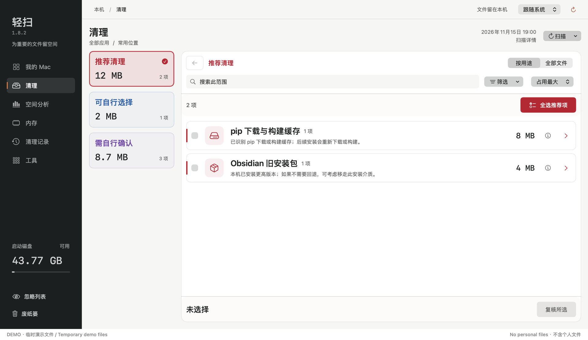
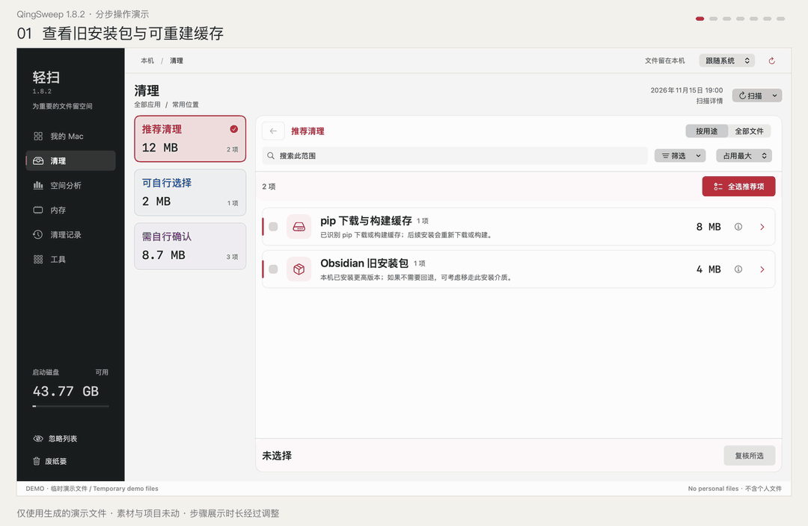
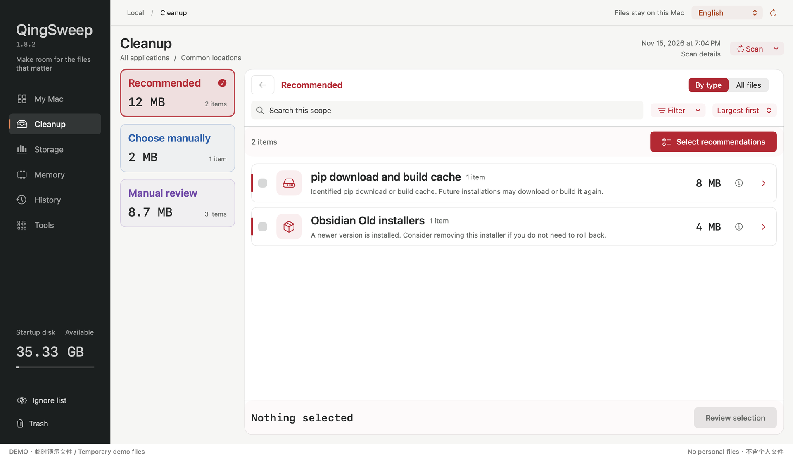
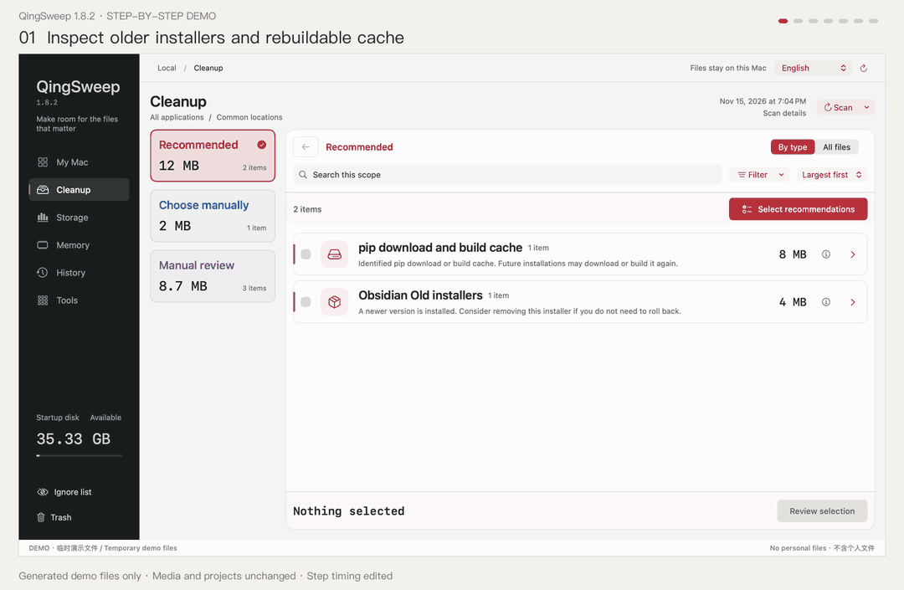
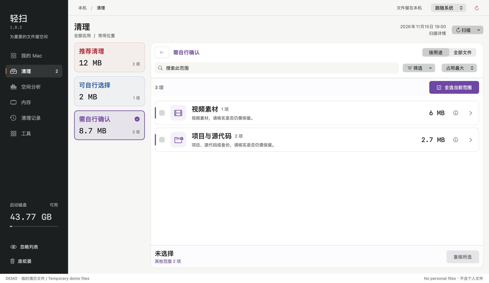
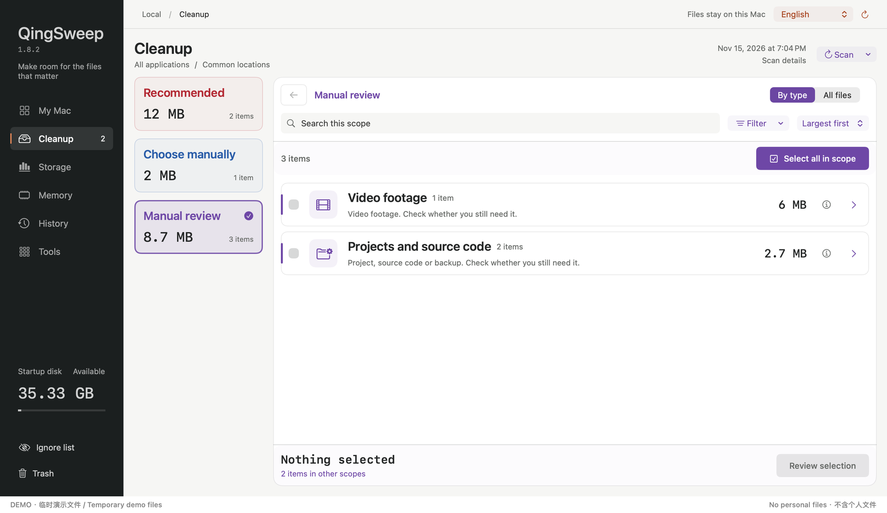
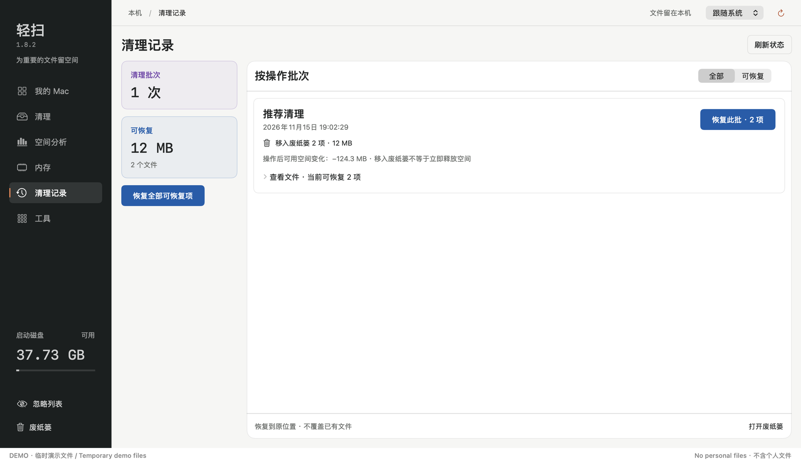
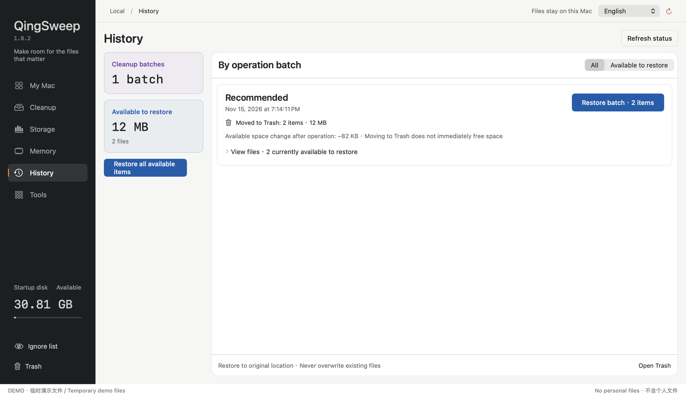

# 轻扫 QingSweep 1.8.2 Beta

**看清 Mac 空间占用，确认以后再清理。**  
**See what uses your Mac's storage. Review before you clean.**

English / 简体中文 · MIT · Apple Silicon · 本地运行 / Local processing  
**Beta：暂未 Developer ID 签名或 Apple 公证 / Not Developer ID signed or Apple-notarized.**

[下载 Mac 安装包 / Download app](https://github.com/FishyJ10312/QingSweep/releases/download/v1.8.2-beta/QingSweep-1.8.2-beta-arm64.zip) · [中文安装说明](https://github.com/FishyJ10312/QingSweep/blob/main/docs/INSTALL.zh-CN.md) · [English installation](https://github.com/FishyJ10312/QingSweep/blob/main/docs/INSTALL.en.md) · [宣传素材包 / Media kit](https://github.com/FishyJ10312/QingSweep/releases/download/v1.8.2-beta/QingSweep-1.8.2-beta-media-kit.zip)

## 简体中文界面与演示

把旧安装包、可重建缓存与个人文件分开查看。**素材和项目默认不勾选**，主动纳入清理时需要复核及二次确认。



**选择推荐项 → 复核 → 移到废纸篓 → 按批次恢复。** 添加推荐项后，素材和项目仍未勾选。



[下载中文演示 MP4（26 秒）](https://github.com/FishyJ10312/QingSweep/releases/download/v1.8.2-beta/cleanup-restore-zh-CN.mp4)

## English interface and demo

Review installers, rebuildable cache and personal files separately. **Media and projects start unselected.** Including them requires review and a second confirmation.



**Select recommendations → review → move to Trash → restore a batch.** Adding recommendations leaves media and projects unselected.



[Download English demo MP4 (26 seconds)](https://github.com/FishyJ10312/QingSweep/releases/download/v1.8.2-beta/cleanup-restore-en.mp4)

<details>
<summary>更多界面：默认选择与批次恢复 / More screenshots: selection defaults and batch restore</summary>

### 素材与项目默认不勾选 / Media and projects start unselected





### 清理记录与批次恢复 / History and batch restore





</details>

这些是隔离环境中的实际操作画面，按步骤整理并调整停留时长。每种语言各有两项临时文件实际移入废纸篓并恢复，恢复后内容核验一致；不含个人文件名或用户路径。  
These are step-by-step captures of actual operations in an isolated demo environment, with edited display timing. Two generated files were moved and restored in each language, with original contents verified. No personal filenames or user paths appear. [制作与核验说明 / Demo notes](https://github.com/FishyJ10312/QingSweep/blob/main/docs/DEMO.md)

## 本版功能 / In this release

- **双语与 MIT / Languages and MIT:** 同一安装包支持 English / 简体中文，顶部切换并记住选择；补齐 MIT 与双语说明。 One app with a persistent language choice, MIT license and bilingual documentation.
- **浏览与分类 / Browse and classify:** 按应用或文件夹查看空间，保留搜索、分页、返回上级与分类依据。 Application/folder browsing, search, pagination, parent navigation and classification evidence.
- **复核与恢复 / Review and restore:** 推荐项、可自行选择、需自行确认分开；保留手动选择、逐项日志、重启核对和批次恢复。 Separate cleanup groups, manual selection, per-file journals, restart reconciliation and batch restore.

清理只移到废纸篓，应用不会清空废纸篓；移入容量不等于立即释放空间。恢复依赖文件仍在废纸篓且通过核验，不覆盖原位置已有文件，也不能替代备份。  
Cleanup moves files to Trash and never empties it. Moved bytes are not immediately freed space. Restore requires the files to remain in Trash and pass checks, never overwrites existing destinations, and is not a backup.

最低编译版本 macOS 14，实机验收为 Apple Silicon / macOS 27.2；其他 Mac 的默认安全设置首次启动、macOS 14 实机及真实外置盘拔插仍待验证。首次启动与按需授权请查看上方安装说明，建议先用临时文件夹试用。  
Built for macOS 14 or later; device validation on Apple Silicon / macOS 27.2. Another Mac under default Gatekeeper, actual macOS 14 hardware and physical drive disconnection remain unverified. Follow the installation guide and start with a disposable folder.

<details>
<summary>版本与验证 / Build and validation</summary>

应用 **1.8.2（17）**；已有验收记录为 650 项检查，包括 26 项语言检查，另检查 787 条英文消息和 30,017 文件完整清单。保留 9 个真实 SIGKILL 窗口检查。原文件名、路径、扫描标识与恢复身份保持不变，英文搜索支持旧中文索引归属。

Build **1.8.2 (17)** has recorded acceptance of 650 checks, including 26 localization checks, plus 787 catalogue entries and a 30,017-file complete-list fixture. Nine actual SIGKILL windows are retained. File names, paths and recovery identities stay verbatim; English search includes older Chinese-indexed category titles.

这次整理了发布页、演示与分享资料，原安装包、源码附件和版本标签保持不变。素材包包含 6 张截图、2 段 GIF、2 段 MP4，以及中英文短版与详细文案；新增媒体附件使用独立校验表，原 `SHA256SUMS.txt` 保留。

This publication update adds the gallery, demos and share material. The original app, source archive and version tag remain unchanged. The media kit contains six screenshots, two GIFs, two MP4s and bilingual short/long copy. A separate media checksum list is supplied; the original `SHA256SUMS.txt` is retained.

[中文验证记录](https://github.com/FishyJ10312/QingSweep/blob/main/docs/VALIDATION.zh-CN.md) · [English validation](https://github.com/FishyJ10312/QingSweep/blob/main/docs/VALIDATION.en.md) · [隐私 / Privacy](https://github.com/FishyJ10312/QingSweep/blob/main/docs/PRIVACY.en.md) · [MIT License](https://github.com/FishyJ10312/QingSweep/blob/main/LICENSE)

</details>

## 可直接复制的分享文案 / Ready-to-share copy

<details>
<summary>中文短版：展开后复制</summary>

```text
轻扫 QingSweep 1.8.2 Beta：看清 Mac 空间占用，确认以后再清理。

English / 简体中文，MIT 开源，本地运行。素材和项目默认不勾选；清理只移到废纸篓，支持批次恢复。

发布页附中英文截图和 26 秒清理、恢复演示。Apple Silicon 测试版，暂未 Apple 公证，建议先用临时文件夹试用。

下载与演示：https://github.com/FishyJ10312/QingSweep/releases/tag/v1.8.2-beta
```

</details>

<details>
<summary>English short post: expand and copy</summary>

```text
QingSweep 1.8.2 Beta — see what uses your Mac's storage. Review before you clean.

English / 简体中文 · MIT · Local processing. Media and projects start unselected. Cleanup moves files to Trash, with batch restore in History.

The release includes bilingual screenshots and a 26-second cleanup-and-restore demo in each language. Apple Silicon Beta, not Apple-notarized. Try a disposable folder first.

Download and demos: https://github.com/FishyJ10312/QingSweep/releases/tag/v1.8.2-beta
```

</details>

[完整中文宣传文案](https://github.com/FishyJ10312/QingSweep/blob/main/docs/PROMO.zh-CN.md) · [Full English launch copy](https://github.com/FishyJ10312/QingSweep/blob/main/docs/PROMO.en.md) · [打包下载所有宣传素材 / Download media kit](https://github.com/FishyJ10312/QingSweep/releases/download/v1.8.2-beta/QingSweep-1.8.2-beta-media-kit.zip)
