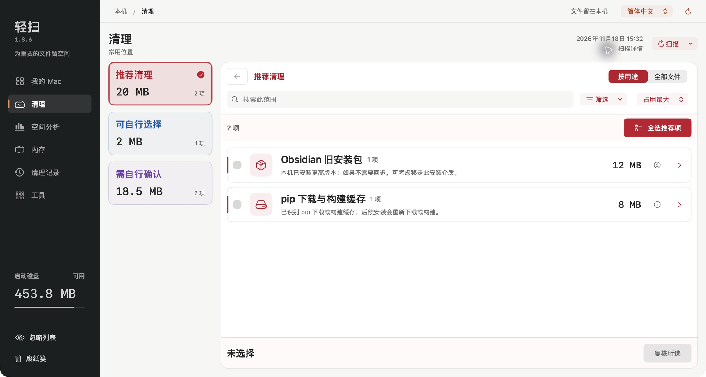
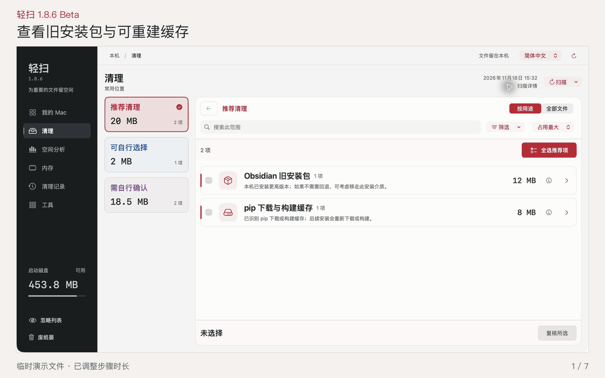
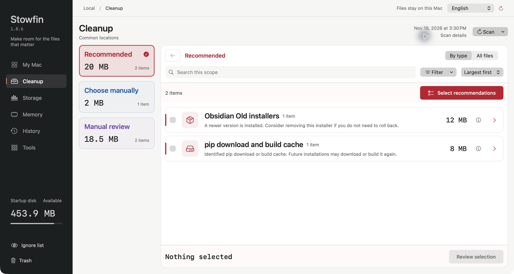
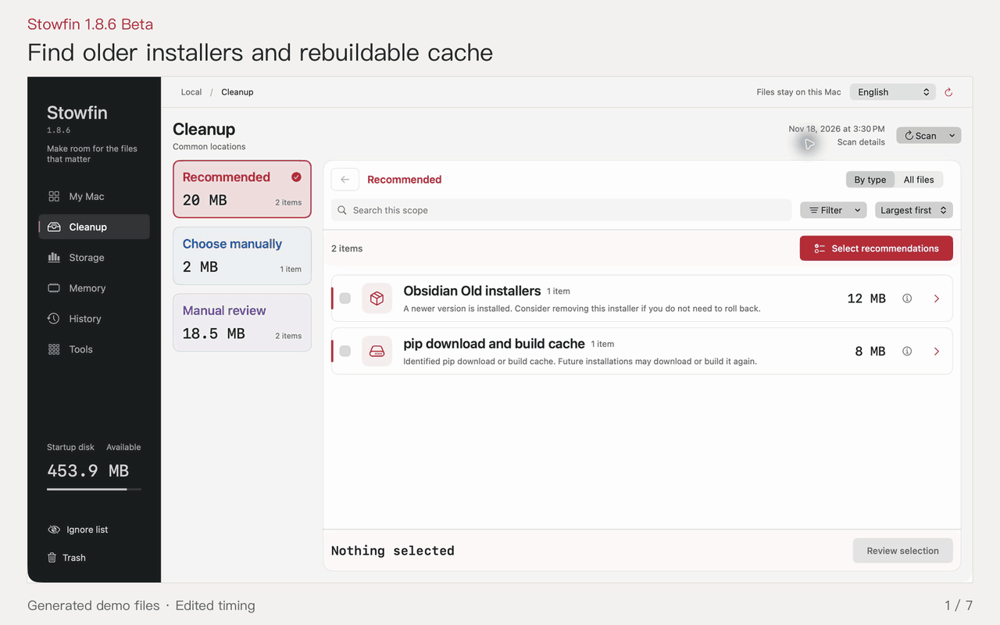
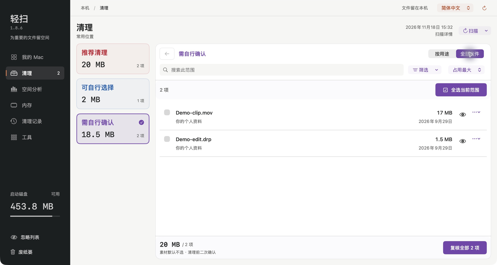
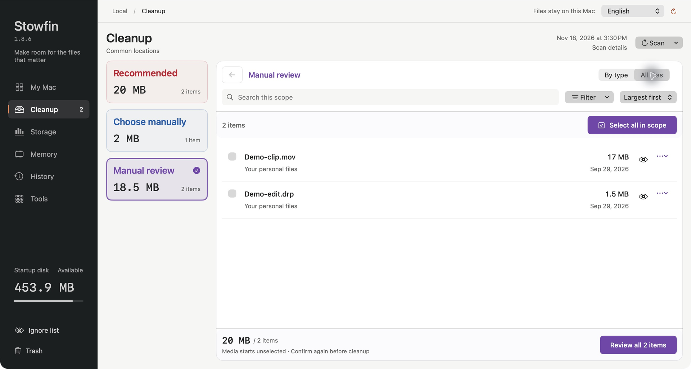
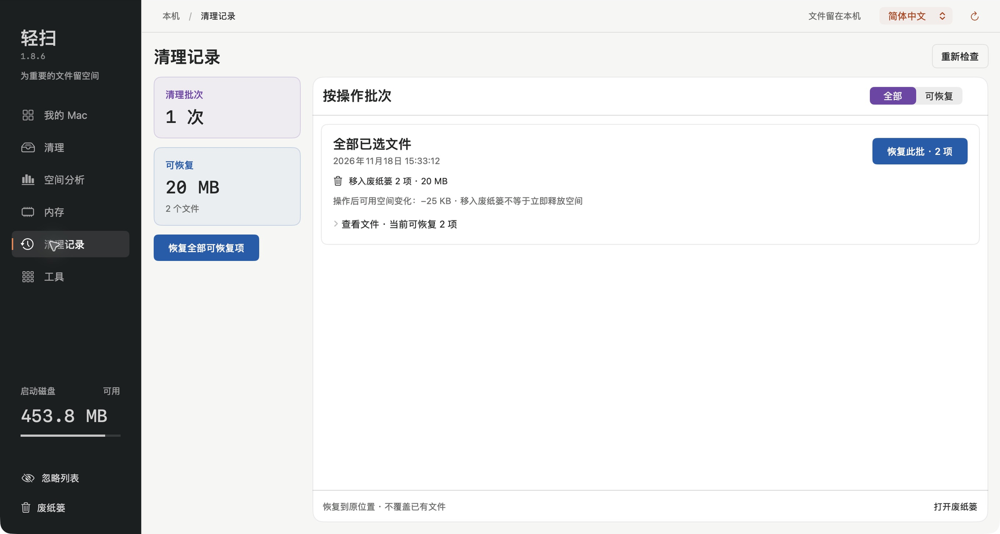
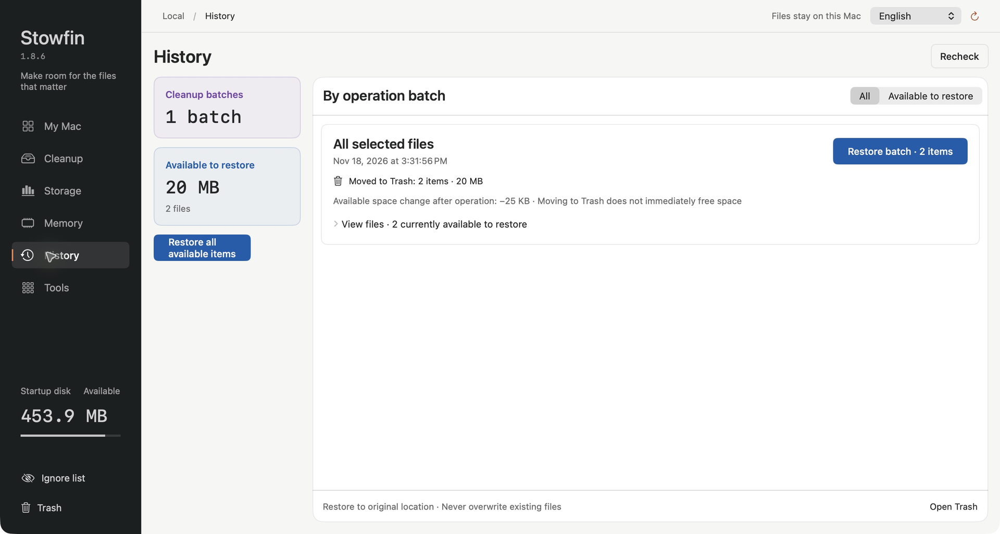

# Stowfin 1.8.6 Beta · 轻扫

**Apple Silicon · 构建 21 / Build 21 · macOS 14+ · MIT**

新版安装包在英文中显示 **Stowfin**，在简体中文中显示**轻扫**。可在窗口顶部的语言菜单切换界面语言。  
The new installer displays **Stowfin** in English and **轻扫** in Simplified Chinese. Change the interface language from the menu at the top of the window.

**暂未经过 Apple 公证。** Beta 安装包使用本机签名证书，未使用 Apple Developer ID 签名。  
**This Beta ships without Apple notarization or a Developer ID signature.** It uses a local signing certificate.

[下载 Apple 芯片版 / Download for Apple Silicon](https://github.com/FishyJ10312/Stowfin/releases/download/v1.8.6-beta/Stowfin-1.8.6-beta-arm64.zip) · [中文安装与授权](https://github.com/FishyJ10312/Stowfin/blob/v1.8.6-beta/docs/INSTALL.zh-CN.md) · [English installation and permissions](https://github.com/FishyJ10312/Stowfin/blob/v1.8.6-beta/docs/INSTALL.en.md)

**素材和项目默认不勾选。** 可以主动单选、按组选择或全选，二次确认后才会移到废纸篓。  
**Media and projects are unselected by default.** Select them individually, by group or with Select All. Moving them to Trash requires a second confirmation.

## 截图与清理恢复演示 / Screenshots and demos

以下是 1.8.6 Beta 的实际操作。中英文各用一组临时文件，清理和恢复的两项文件内容均已核验。画面不含个人文件名或路径。  
Both walkthroughs show the 1.8.6 Beta. Each moved two generated files to Trash and restored them with their contents verified. No personal file names or paths appear.

### 简体中文 · 轻扫

[下载中文演示 MP4](https://github.com/FishyJ10312/Stowfin/releases/download/v1.8.6-beta/cleanup-restore-zh-CN.mp4)

### English · Stowfin

[Download English demo MP4](https://github.com/FishyJ10312/Stowfin/releases/download/v1.8.6-beta/cleanup-restore-en.mp4)

素材与项目默认选择、清理记录 / Selection defaults and batch history

[制作与核验说明 / Demo notes](DEMO.md)

## 验证 / Validation

126 项专项检查通过，覆盖语言、素材分类、范围和复核。在 macOS 27.2 的 Apple 芯片 Mac 上用临时文件实测中英文显示名、推荐项选择和二次确认。另一台 Mac 在默认安全设置下的首次启动待验证。  
126 checks passed for localization, media classification, scope and review. On Apple Silicon running macOS 27.2, generated files were used to verify both display names, recommendation selection and the second confirmation. First launch on another Mac under default security settings is still awaiting validation.

[SHA-256 校验值 / Checksums](https://github.com/FishyJ10312/Stowfin/releases/download/v1.8.6-beta/SHA256SUMS.txt) · [验收记录 / Validation record](https://github.com/FishyJ10312/Stowfin/blob/v1.8.6-beta/docs/validation-1.8.6-beta.json)
